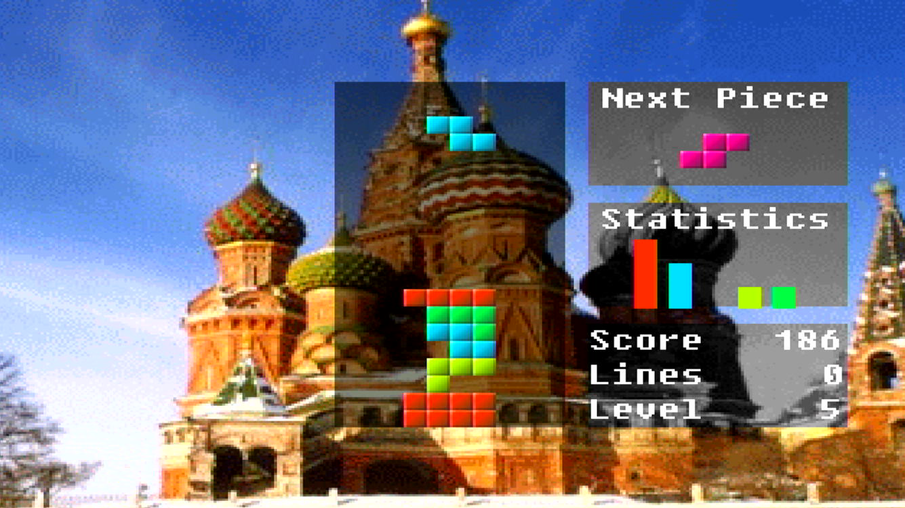
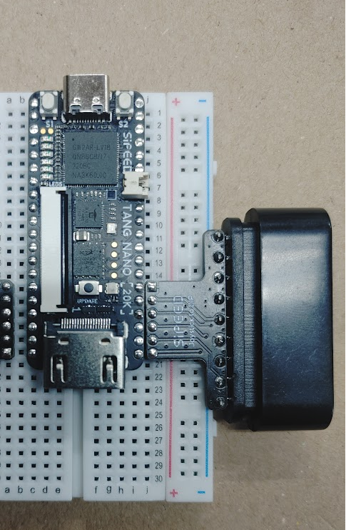
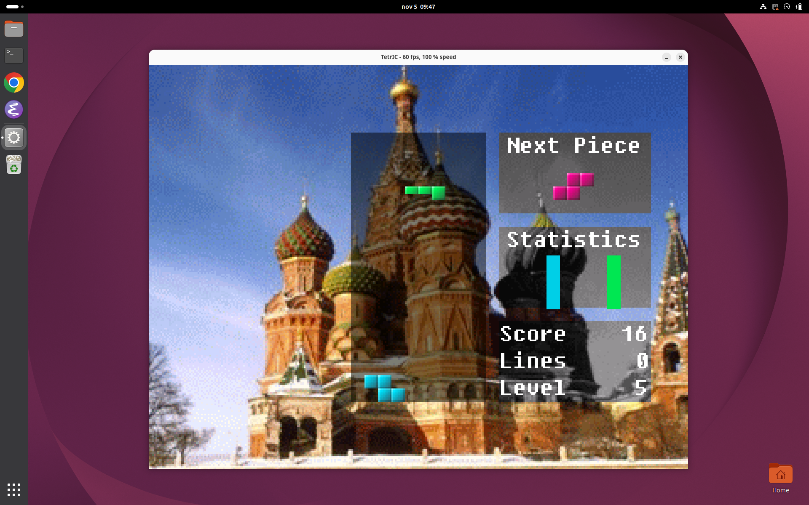

# TetrIC 2025



TetrIC is a falling-blocks game that runs on its own processor, graphics and sound hardware.
This repository is a port of it to the Sipeed Tang Nano 20K FPGA board.

## Background

TetrIC started as an ASIC project in the master's programme in Electrical Engineering at Lund
University of Technology (LTH), 2000–2001. The whole system was designed in VHDL:

* a 5-stage MIPS-like processor;
* a graphics unit (the "gfxbox");
* a sound unit with a MOD player (the "ljudbox");
* a joystick controller.

The game was written in assembler for that processor.

In 2025–2026 the design was converted to Verilog for the Tang Nano 20K, using Sipeed's Retro
Game kit: the board, two gamepads and the gamepad adapter. The original VHDL is in the git
history up to commit `39a567d` (`old_vhdl/`).

The conversion moved the system onto the board's hardware:

* **Memory:** the system runs from the board's SDRAM. The program is copied there from the SPI
  flash at start.
* **Video and sound:** the picture goes out over HDMI, and the sound is embedded in the same
  HDMI signal.
* **Controls:** the game is played with a PlayStation-style gamepad.

| Tang Nano 20K | Retro Game kit, gamepad adapter and HDMI connected |
|---|---|
|  |  |

Images: [Sipeed wiki](https://wiki.sipeed.com/hardware/en/tang/tang-nano-20k/nano-20k.html).

## Layout

| Folder | |
|---|---|
| `rtl/` | the system RTL (`rtl/top.v`: CPU, SDRAM, memory controller, video, sound, gamepad, flash reader) |
| `tangnano20k/` | the Tang Nano 20K top level, PLLs and pins of the system, a built bitstream in `bitstream/` |
| `tangnano20k_test/` | FPGA test projects: `hdmi` (HDMI 4 kHz tone), `sdram`, `sdram_video`, `lcd_480x272`, `lcd_800x480` |
| `sim/models/` | simulation models: SPI flash, SDRAM, PS2 gamepad, Gowin primitives |
| `sim/system/` | full-system simulation (iverilog) |
| `sim/sound/` | sound unit simulation (Verilator) against `tools/sound_ref.py` |
| `sim/pytest/` | module testbenches ([digsim](https://github.com/freand76/digsim)) |
| `game_code/` | the TetrIC game |
| `test_code/` | test programs |
| `tools/` | assembler (`abnasm.py`), sound reference model (`sound_ref.py`), MOD converter (`mod2tetric.py`) |
| `emulator/` | TetrIC emulator in Rust (Linux / Windows), checked against the RTL simulation |

## Install the tools

The flow is fully open source:

| Tool | Used for | Source |
|---|---|---|
| Yosys | synthesis | <https://github.com/YosysHQ/yosys> |
| nextpnr-himbaechel (Gowin) | place and route | <https://github.com/YosysHQ/nextpnr> |
| Apicula (`apycula`, `gowin_pack`) | Gowin chip database and bitstream packing | <https://github.com/YosysHQ/apicula> |
| openFPGALoader | programming the board | <https://github.com/trabucayre/openFPGALoader> |
| Icarus Verilog, Verilator | simulation | <https://github.com/steveicarus/iverilog>, <https://github.com/verilator/verilator> |
| uv | runs all Python code | <https://github.com/astral-sh/uv> |
| digsim | module testbenches, Verilog formatter | <https://github.com/freand76/digsim> |

Tested with:

* Ubuntu 26.04;
* Yosys 0.52;
* nextpnr 0.11.1 (git), Apicula 0.35;
* openFPGALoader 1.2.0;
* Icarus Verilog 14 (devel), Verilator 5.032.

### apt packages: Yosys, simulators and build dependencies

```
sudo apt install yosys iverilog verilator gtkwave git cmake build-essential pkg-config \
    python3-dev libboost-all-dev libeigen3-dev \
    libftdi1-dev libhidapi-dev libudev-dev zlib1g-dev
```

### uv

All Python code (the assembler, the tools, Apicula, the testbenches) runs with uv:

```
curl -LsSf https://astral.sh/uv/install.sh | sh
```

The scripts have a uv shebang (`#!/usr/bin/env -S uv run --script`), and the Makefiles call
them with `uv run --script`. uv fetches a Python and any packages the script needs.

### Apicula (gowin_pack)

```
uv tool install apycula==0.35
```

This puts `gowin_pack` in `~/.local/bin`. nextpnr builds its Gowin chip database with the same
Apicula, so install Apicula first. Rebuild nextpnr if you change the Apicula version.

### nextpnr-himbaechel

```
git clone https://github.com/YosysHQ/nextpnr.git
cd nextpnr
git submodule update --init --recursive
mkdir build && cd build
cmake .. -DARCH=himbaechel -DHIMBAECHEL_UARCH=gowin -DHIMBAECHEL_GOWIN_DEVICES=GW2A-18C \
    -DAPYCULA_INSTALL_PREFIX=$(uv tool dir)/apycula
make -j$(nproc)
sudo make install
```

### openFPGALoader

```
git clone https://github.com/trabucayre/openFPGALoader.git
cd openFPGALoader
mkdir build && cd build
cmake ..
make -j$(nproc)
sudo make install
sudo cp ../99-openfpgaloader.rules /etc/udev/rules.d/
sudo udevadm control --reload-rules && sudo udevadm trigger
```

The udev rules let you program the board without sudo. You may need to log in again.

## Connect the gamepad

The Retro Game kit has two gamepad adapters with 6 pins each. Put the Tang Nano 20K on the
breadboard with the USB-C connector at row 1. Each adapter goes on its own side of the board,
in rows 15–20, next to the six header pins at the HDMI end. Plug the screen into HDMI.

TetrIC reads one gamepad: the one in the adapter on the side with the **S1** button, FPGA pins
17–20. With USB-C at the top that is the **left** side. The adapter on the S2 side is
connected to the second gamepad pins (52, 53, 71, 72), which TetrIC doesn't use.



In the picture, the right adapter (S2 side) is the one with the gamepad connector in view. The
left adapter, the one TetrIC reads, is at the left edge of the picture.

The six adapter pins (`tangnano20k/tangnano20k.cst`; these are the pins of the NESTang retro
game firmware too), in header order from row 15 to row 20:

| Adapter pin | Signal in the design | FPGA pin |
|---|---|---|
| CLK | `ds_clk` | 17 |
| CMD | `ds_mosi` (command to the pad) | 20 |
| DATA | `ds_miso` (data from the pad) | 19 |
| ATTN | `ds_cs` | 18 |
| 3V3 | power | 3V3 |
| GND | ground | GND |

Pins 17–20 are shared with LEDs 2–5 on the board. The pin diagram shows them in the bottom
left corner, marked "Joystick" (top view, USB-C up):


Pin diagram: [Sipeed wiki](https://wiki.sipeed.com/hardware/en/tang/tang-nano-20k/nano-20k.html).

## Quick start: play the game

With the tools installed (see [Install the tools](#install-the-tools)), unplug the gamepad and
the HDMI cable, then flash the built bitstream and the game:

```
openFPGALoader -btangnano20k -f tangnano20k/bitstream/tetric.fs
make -C game_code program-flash
```

Plug the gamepad and HDMI back in and power the board up again.

### Without the board: the emulator

`emulator/` is an emulator of the whole system in Rust, with picture, sound,
MOD music and keyboard or USB gamepad, for Linux and Windows. Its CPU runs
instruction for instruction like the RTL simulation. See
[emulator/README.md](emulator/README.md).

```
make -C emulator run        # or: emulator/target/release/tetric_emu --flash game_code/out/TetrIC.bin
```



### Controls

| Gamepad | In the game |
|---|---|
| left / right | move the piece |
| up | soft drop (one step down) |
| down | hard drop |
| square, circle | rotate counterclockwise |
| cross | rotate clockwise |

## Build and program the board

* **Flash layout:**
  * the bitstream at flash address 0;
  * the program (game or test code) at 0x500000. The system copies it to SDRAM at start.
* **If programming fails** (JEDEC id `ff`, "Non-JTAG configuration is active"): unplug the
  gamepad and the HDMI cable, then try again.

### Bitstream

```
make -C tangnano20k                     # synth, place and route, pack: tangnano20k/out/top.fs
make -C tangnano20k program-flash-top   # write out/top.fs to flash
make -C tangnano20k program-sram-top    # or load it to SRAM (lost at power off)
```

* The program targets don't build anything: run `make -C tangnano20k` first.
* `make -C tangnano20k synth` runs only Yosys.
* `make -C tangnano20k check` runs only an iverilog syntax check.

A built bitstream is in `tangnano20k/bitstream/tetric.fs`. To flash it without building:

```
openFPGALoader -btangnano20k -f tangnano20k/bitstream/tetric.fs
```

### The game

```
make -C game_code                       # assemble: game_code/out/TetrIC.bin
make -C game_code program-flash         # assemble and write it to flash at 0x500000
```

### Test programs

```
make -C test_code                                       # test_code/prg.bin (and MEM.TXT)
make -C test_code program-flash-code                    # write prg.bin to flash at 0x500000
make -C test_code program-flash-code PRG=sound_test     # or another program, e.g. sound_test.s
```

| Program | |
|---|---|
| `prg.s` | CPU and memory test with UART output (the program of `make -C sim/system run`) |
| `sound_test.s` | sound unit effect channels 4–7 |
| `fwd_test.s` | register forwarding (assembled with `--hazards=off`, the hazard is deliberate) |
| `video_test.s` | video registers: colour bars, switching every 2 seconds |
| `pad_test.s` | gamepad: prints the buttons on the UART and draws them on the screen |
| `bars.s` | the "Bars" effect of the TetrIC intro |

### FPGA test projects

Each folder in `tangnano20k_test/` has the same targets:

* `make` builds the bitstream into `out/top.fs`;
* `program-sram-top` and `program-flash-top` program it.

Some folders have more:

| Project | Extra targets |
|---|---|
| `hdmi` | `sim`: decodes the HDMI stream and checks the 4 kHz audio sine (`SIM_MS=50`) |
| `sdram` | `run`: iverilog simulation (UART "Hello World"); `program-text`: writes `sdram_test.bin` to flash at 0x600000 |
| `sdram_video` | `sim`, `sim-pixel`, `image`, `program-image`; bitstream in `out/pll50/` (see its [README](tangnano20k_test/sdram_video/README.md)) |
| `lcd_480x272`, `lcd_800x480` | `sim` |

The LCD testbenches run for 37 ms. The LCD controller only enables its output after 7 frames,
so the display-enable signal is never set in these runs.

## Simulation

### Full system (`sim/system`, iverilog)

The simulation runs `rtl/top.v` with the SPI flash, SDRAM and gamepad models. The test program
is loaded from the flash model (`MEM.TXT`).

```
make -C sim/system run      # test_code/prg.s: UART output, SDRAM model and video frame checks
make -C sim/system sound    # test_code/sound_test.s: audio bit exact against tools/sound_ref.py
make -C sim/system fwd      # test_code/fwd_test.s: register forwarding
make -C sim/system check    # all three
```

Each test runs in `sim/system/out/<test>/`, with its logs there. The sound test also writes
`sound.wav`.

### The game in simulation (`sim/system`, Verilator)

`make -C sim/system game` runs `game_code` in a Verilator build of the same testbench, at about
5 ms of game per second, so a few seconds of game take 15–20 minutes. By default it runs 5 s and
presses START at 2 s. `GAME_ARGS` sets the testbench options:

```
make -C sim/system game GAME_ARGS="+fix_beam +swaplog=swaps.txt +stats +run_ns=5000000000"
```

| Option | |
|---|---|
| `+press_ns=<t> +release_ns=<t>` | press START; `+press2_ns`/`+release2_ns` and `+press3_*` press again, CROSS with `+press2_cross` |
| `+fix_beam` | MFC1 reads the beam position as 0, so the random seed doesn't depend on the CPU timing |
| `+swaplog=<file>` | one line per screen swap: a hash of the shown picture and the video registers |
| `+stats` | executed instructions and nops; `+idle_lo=<hex> +idle_hi=<hex>` counts a PC range (the frame wait loop) |
| `+profile=<file>` | executed instructions per address; `+profile_cycles` counts clock cycles |
| `+run_ns=<ns> +frames=<n> +ppm` | stop time, and the last frames as `frame0.ppm`, ... |
| `+trace` | CPU, register and peripheral trace (off by default) |

The `UART` output shows an `L` for every game frame that was not ready in time.

Two versions of the game can be compared frame by frame: with `+fix_beam`, game frame k has the
same `swaplog` hash in both, whatever the timing. That holds until a menu choice, because the
random seed also uses the video frame number.

### Sound unit (`sim/sound`, Verilator)

The sound unit runs on its own, driven by a register script. The output is checked bit exact
against the Python model `tools/sound_ref.py`, and written to `out/<test>.wav`.

```
make -C game_code                       # beat and mod use the game binary
make -C sim/sound beat                  # the game's beat loop
make -C sim/sound mod MOD_MS=10000      # the game music (MOD player), MOD_MS ms (default 3000)
make -C sim/sound fxmod                 # MOD effects test song, 3.2 s
```

* `SIM=iverilog` uses Icarus Verilog instead of Verilator, which is about 25 times slower.
* `SAMPLE_DIV=96` makes the simulation faster. That is fewer clocks per sample than the 525 the
  hardware uses.

### Module testbenches (`sim/pytest`, digsim)

The testbenches (`sim/pytest/**/test_*_tb.py`) test the modules in `rtl/` with
[digsim](https://github.com/freand76/digsim) 1.10.0. They run in a temporary uv environment
(Python 3.12, digsim 1.10.0, pytest):

```
./uv_run_pytest.sh
./uv_run_pytest.sh sim/pytest/processor/alu -k overflow     # arguments go to pytest
```

## The assembler: `tools/abnasm.py`

The assembler is a Python port of `abnasm.pl`, the Perl assembler of the original project
(Anders Berkeman, 2002):

```
tools/abnasm.py prg.s                   # -> prg.1 (listing), prg.2 (hex), prg.bin (big endian words)
tools/abnasm.py --hazards=warn prg.s    # report pipeline hazards without failing
tools/abnasm.py --suggest-nops prg.s    # list the nops that can be removed
tools/abnasm.py --remove-nops new.s prg.s
```

### Syntax

* **Lines:** `label:  MNEMONIC args  ; comment` (`#` also starts a comment). Labels start in
  column 0, and instructions are indented.
* **Registers:** `$0`..`$31`, the MIPS names (`$t0`, `$sp`, `$ra`, ...), and TetrIC aliases.
* **Numbers:** `123`, `-5`, `0x1f`, `0b101`, `017` (octal) and `'a'`.
* **Expressions:** immediates can be labels or expressions with `+ - * / ^ ~ | &` and `[ ]`.
  `label.L` / `label.H` give the low / high 16 bits.
* **Directives:** `.ORG`, `.DC`, `.PAD`, `.FILE name [words]` (default: the whole file),
  `.ASCII`, `.EQU` / `=`, `.END`, `.MACRO` / `.ENDMACRO`, and the translation directives
  `.TRANSTAB`, `.TR`, `.TRANSLATE`, `.TRANSOFF`.

### Differences from the Perl version

The output is the same as the Perl version's, except:

* an unknown register name is an error (Perl used register 0);
* macros can use other macros (Perl dropped the rest of the outer macro);
* negative `.dc` / `.pad` values are stored correctly (see below).

### 32-bit and 64-bit numbers

The Perl assembler was written for a 32-bit Perl, and on a 64-bit Perl it gives wrong code
without any message: every negative `.dc` / `.pad` value is stored as `0xffffffff` (-1). The
cause is that `sprintf("%x")` of a negative number gives 16 hex digits, and `pack("H8")` keeps
only the first 8.

`abnasm.py` stores every value as a 32-bit two's complement number, as the 32-bit Perl did:

* **Negative numbers:** `.dc -5` becomes `0xfffffffb`.
* **Wider than 32 bits:** `.dc` values are cut to the low 32 bits without a warning.
  `.dc 0x123456789` becomes `0x23456789`, and `.dc 4294967296` becomes `0`.
* **Immediates wider than 16 bits** (26 for `j`/`jal`, 5 for shift amounts): you get only a
  warning ("Integer arg exceeds 16 bits"), and the value is cut to the field size.
* **16-bit immediates** are stored as `0xffff` for `-1`. The CPU extends them as listed in
  [Processor caveats](#processor-caveats-delay-slots-and-nops). Load a 32-bit constant with
  `lui reg, VAL.H` + `ori reg, reg, VAL.L`.
* **Division** in expressions rounds down: `7/2` is `3`.

## Music: `tools/mod2tetric.py`

Converts a 4 channel ProTracker MOD to the song format of the sound unit's MOD player
(`rtl/sound/sound_seq.v`), and can render a preview with the sound unit model:

```
tools/mod2tetric.py song.mod game_code/Data/mod_song.raw --wav preview.wav --seconds 30
```

* **Using it in the game:** include the file in place of `Data/mod_gamemusic.raw` in
  `game_code/FXMusic.s` (`TetricMod: .file Data/mod_song.raw`).
* **Memory:** the program, with the song, is loaded at word 0, and work RAM starts at word
  0x20000. So the whole program must stay below 512 KB.
* **Tempo:** a song tempo (`Fxx` >= 32) is not played. The tick is `WAITCLK`, which
  `TLib/Sound.s` sets to 50 Hz (125 BPM). The converter prints the value for the song's tempo.
* **Effects that are dropped:** arpeggio, vibrato, tremolo, sample offset, and the `E`
  effects other than `E1`/`E2`/`EA`/`EB`. The converter counts them.
* **Finetune:** put into the note periods.
* **Loops:** kept exact. `--loops round` rounds them to whole words instead, which uses less
  memory, as the 2001 converter did.

The game music (`Data/mod_gamemusic.raw`) is "Tetris mania". Converting that MOD with
`--no-finetune --loops round` gives the same song: 99.99 % of the samples of a 30 s preview
are identical.

## Processor caveats: delay slots and nops

The processor has a 5-stage pipeline with **no hazard detection and no flush**. Every
instruction that is fetched is executed, and not all register dependencies are forwarded. So
the program has to contain nops, or other independent instructions, in these places:

| Case | Nops needed |
|---|---|
| after `beq bne bge bgt beqz bnez bgez bgtz b`, `jr`, `jalr` | **3** (delay slots, always executed) |
| after `j`, `jal` | **1** |
| after `lw`, before the loaded register is used | **1** |
| before `sw`: the stored register (`rt`) must be written 3 or more instructions earlier | **2** |
| branch or jump in a delay slot | not allowed |

* **`jal` returns to `jal` + 1.** The delay-slot instruction runs again after the return, so
  keep it a nop.
* **`$ra` reads as 0** in the `jal` delay slot.

`abnasm.py` checks these rules along every execution path, and by default a hazard is an error
and no `.bin` is written. The details, the RTL reasons and the nop removal are in
[rtl/processor/PIPELINE_HAZARDS.md](rtl/processor/PIPELINE_HAZARDS.md).

Other things to know about the processor:

* the program counter counts words, not bytes;
* `bgt` / `bge` compare unsigned;
* `sll` / `sra` / `srl` take the source in `rs`, not `rt` as in MIPS;
* there are no multiply or divide instructions.

The 16-bit immediates are extended in three different ways, as in the original design:

| Extension | Instructions |
|---|---|
| sign extended | `addi`, `slti`, `lw`, `sw`, branches |
| zero extended | `addiu`, `sltiu`, `ori`, `xori`, `lui` |
| upper 16 bits set to ones | `andi` |

So `andi` only changes the low 16 bits, where MIPS clears the upper half: `andi $t0, $t1, 7`
keeps bits 31:16 of `$t1`.

## Code formatting

The Verilog files are formatted with the [digsim](https://github.com/freand76/digsim) 1.10.0
formatter. The Python code is formatted and checked with ruff, using the rules of digsim (in
`ruff.toml`):

```
./uv_format_verilog.sh          # or --check to only list the files that would change
./uv_ruff.sh                    # ruff format + ruff check
```

# BUGS found

 * The program counter is word based
 * BGT / BGE only handles unsigned values
 * The Perl assembler stored every negative `.dc` / `.pad` value as -1 on a 64-bit Perl (fixed
   in `abnasm.py`)
 * Forwarding from WB was lost when the instruction in EX did not write a
   register but named the same one (fixed, `make -C sim/system fwd`)
