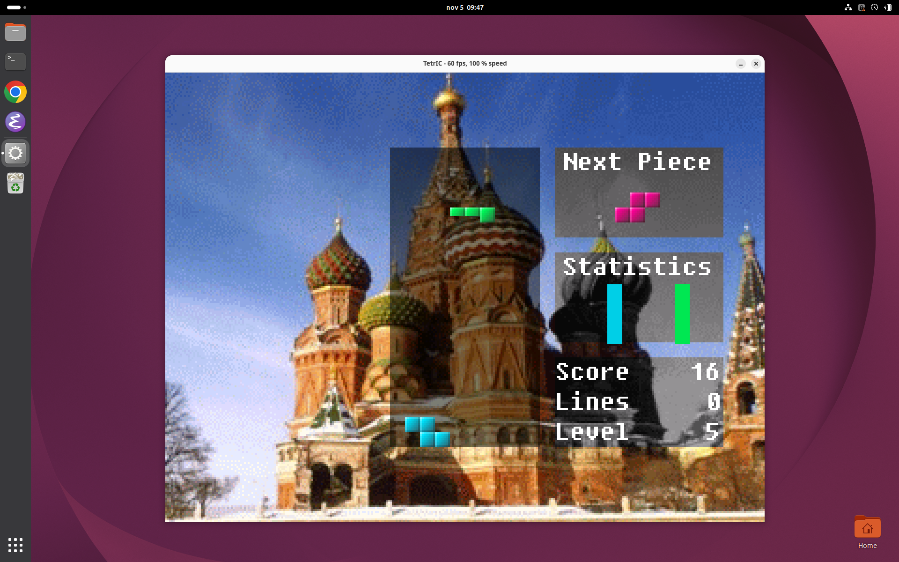

# tetric_emu: TetrIC emulator

An emulator of the TetrIC ASIC as built for the Tang Nano 20K (`rtl/`), written
in Rust. It runs the game with picture, sound (including the MOD player) and a
keyboard or USB gamepad, on Linux x86_64 and Windows x86_64.

```
./tetric_emu --flash game_code/out/TetrIC.bin
```



## Build

Install Rust with [rustup](https://rustup.rs/). Linux needs the ALSA, X11 and
udev development packages (sound, window, gamepads):

```
sudo apt install libasound2-dev libx11-dev libxkbcommon-dev libudev-dev
cd emulator
make                # target/release/tetric_emu (cargo build --release)
make run            # builds the game (game_code) and starts it, 2x window
```

Windows, cross compiled on Linux with [cargo-zigbuild](https://github.com/rust-cross/cargo-zigbuild)
(zig from the `ziglang` Python package):

```
rustup target add x86_64-pc-windows-gnu
uv tool install ziglang && ln -s "$(which python-zig)" ~/.local/bin/zig
cargo install cargo-zigbuild
make windows        # target/x86_64-pc-windows-gnu/release/tetric_emu.exe
```

The `.exe` only needs the system DLLs of Windows 10/11. On Windows itself,
`cargo build --release` works as well.

## Use

```
tetric_emu --flash <binary file> [--scale 2] [--mute] [--fps]
```

`--flash` takes the program image (`game_code/out/TetrIC.bin`, copied to SDRAM
address 0 as the board does) or a whole flash image, with the program at
0x500000 as on the board.

| Key | Gamepad | TetrIC |
|---|---|---|
| arrows | d-pad, left stick | joystick |
| Enter | START | START |
| X, Space | cross (south) | B |
| Z, A | square (west) | A |
| C | circle (east) | C |
| Backspace | SELECT | |
| P | | pause |
| Tab (held) | | fast forward |
| F2 | | reset |
| F12 | | screenshot (`tetric_<n>.ppm`) |
| Esc | | quit |

Gamepads go through [gilrs](https://gitlab.com/gilrs-project/gilrs) (evdev on
Linux, XInput / Windows.Gaming.Input on Windows). On Linux the user needs read
access to `/dev/input/event*` (the `input` group on most distributions).

The UART output of the program goes to stdout. The game writes an `L` there
when a game frame was late (more than one 60 Hz frame of work), as on the board.

The window is the visible DVI picture (640 x 480, each image pixel 2 x 2 DVI
pixels at the default PIXREAD) times `--scale`, and is not resizable.

`--fps` prints the frame rate every second:

```
fps: 60.0 shown, 60.0 emulated video frames/s, speed 100.0 %, 0 late game frames, window update 4.4 ms
```

## How it works

| Part | RTL | Model |
|---|---|---|
| CPU | `rtl/processor` | Every pipeline register of `processor.v`; one call is one clock edge on which the pipeline advances. Delay slots, forwarding (the ALU result at distance 1, so `lw` gives the address), the write-through register file, `sw` data without forwarding, the unsigned BGE/BGT and the decoder defaults all come out as in the hardware. |
| Stalls | `icache`, `memory_arbiter`, `memory_controller` | The 32 x 8 word instruction cache is modelled (also stale lines). Extra clocks per event, measured in the RTL simulation of the game: cache line fill 14, load 14, store 3 (posted, averaged), peripheral store 1. |
| Video | `rtl/video` | 800 x 525 clocks per frame (60 Hz). Registers become active at the frame start, each image line is fetched at the time the RTL requests it, into two line memories, with TOPPOS / LEFTPOS / PIXPERLINE / PIXREAD / DELTAADDR as in `video.v`. MFC1 gives frame counter, beam x and line. |
| Sound | `rtl/sound` | The 8 channel mixer and the MOD sequencer, the same model as `tools/sound_ref.py`, at 48 kHz (one sample per 525 clocks). |
| Gamepad | `rtl/gamepad` | MFC2 `{buttons2, buttons1, joy}`, active low, updated 60 times per second. |
| UART | `rtl/uart_tx` | Stores to 0xFxxxxx go to stdout; MFC0 bit 0 is low for one character time (115200 baud). |

The emulation runs in its own thread, paced by the wall clock and trimmed by
up to 2 % to keep the sound queue at 60 ms, so frames and sound stay even.

Speed on an i7-8565U (laptop, 2018), GNOME / XWayland, with sound:

| | |
|---|---|
| headless, one core | 10 s of game in 5.1 s (2.0x real time) |
| window, `--scale 1` | 60.1 frames per second shown (59.0 min), 100 % speed |
| window, `--scale 2` | 59.8 frames per second shown (56.8 min), 100 % speed |
| window, `--scale 3` | 59.5 frames per second shown (56.6 min), 100 % speed |

The hardware shows 60.0 frames per second. The minimum is the lowest
one-second count in a 10 s run.

## Cross check with the RTL

```
make test        # cargo test: test programs (UART output) and CPU quirks
make rtl-check   # ./rtl_check.sh [seconds]: against the Verilator simulation
```

The cross check is the slow part: `rtl_check.sh` takes about 17 minutes, almost
all of it RTL simulation (Verilator: 3.6 s of game in about 9 minutes; iverilog:
the two test programs in about 8 minutes). The emulator side of the same check
takes about 10 seconds (6.2 s for the traced and replayed 3.6 s of game, which
runs at 2x real time without the trace).

`rtl_check.sh` runs the game in the RTL simulation (`sim/system`, Verilator,
START at 2 s and CROSS at 2.7 s) with three logs from `tb_system.v`:

* `+cputrace`: every register write, store and MFC value,
* `+swaplog`: a hash of every frame the game shows, with the video registers,
* `+audio`: the sound unit's register writes, MOD sequencer writes and every
  48 kHz output sample.

The emulator then runs the same program with the MFC values (beam position,
frame counter, gamepad) replayed from the RTL trace (`--mfc-replay`), so both
execute the same instructions whatever the timing, and:

* the CPU trace must be equal line for line,
* every frame hash must be equal,
* `tetric_check audio` replays the logged writes through the emulator's mixer
  and sequencer: every output sample and every sequencer write must be equal,
* the test programs must print the same UART output.

Results (3.6 s of game, 72.8 million instructions):

| Check | Result |
|---|---|
| CPU trace (register writes, stores, MFC values) | 47 829 783 lines equal |
| Frames (image hash + video registers) | 184 of 184 equal |
| Mixer, game (6 s, intro and game music) | 288 731 samples equal |
| Sequencer, game: writes / tick intervals | 324 writes, 174 ticks equal |
| Mixer, MOD effects test (`sim/sound`, fxmod, 3.2 s) | 153 600 samples equal |
| Sequencer, effects test: writes / tick intervals | 849 writes, 153 ticks equal |
| Clocks for the same instructions | 91.08 M emulator, 91.03 M RTL (+0.06 %) |
| Instruction cache misses | 68 479 emulator, 68 465 RTL |
| `test_code/prg.s`, `fwd_test.s` UART output | equal |

Running freely (without the replay), the emulator's timing is an estimate: the
stall clocks are averages, so beam positions read by the program can differ
by a few clocks. The game's random seed comes from the beam position, so its
piece sequence differs from a given RTL run, as it does between two power-ons
of the board. In the sound, the hardware needs about one sample time to
handle a MOD row, so some channel writes come one sample (21 us) later there
than in the emulator (0.6 % of the samples of the effects test differ).

## Checking program and assembler changes

`compare_builds.sh` runs two builds of a program (for example before and after
an assembler change or a nop removal) with `--ideal-timing`. Instructions then
take no time, and when the program waits for the frame counter, time jumps to
the next frame. Every game frame becomes one video frame, so two builds that
differ only in speed must show the same frames:

```
./compare_builds.sh old/TetrIC.bin ../game_code/out/TetrIC.bin
PASS: 583 frames equal
```

This takes a few seconds for 20 s of game, with a short game played by a
gamepad script. Because the pipeline is modelled, a hazard the program does
not handle behaves as on the board:

| Comparison (20 s, ideal timing) | Result |
|---|---|
| game before the nop / PrintASCII rework (commit 24dd553) vs after | 583 of 583 frames equal |
| after vs after with one hazard nop removed (`Joy.s`, lw at distance 1, built with `--hazards=warn`) | differs from frame 196 |

With real timing, frame sequences differ when a build is faster or slower
(the old build ran at 30 fps, the new one at 60 fps), so use `--ideal-timing`
for these comparisons.

## Files

| File | |
|---|---|
| `src/cpu.rs` | pipeline model, decoder, ALU |
| `src/system.rs` | memory, instruction cache, stall timing, peripherals, MFC registers |
| `src/video.rs` | video timing, line fetch, picture |
| `src/sound.rs` | mixer and MOD sequencer |
| `src/main.rs`, `src/frontend.rs` | command line, headless runs, window, sound output, gamepads |
| `src/bin/tetric_check.rs` | sound check against an RTL audio log |
| `tests/programs.rs` | `cargo test` |
| `rtl_check.sh` | the cross check with the RTL simulation |
| `compare_builds.sh` | compare two builds of a program (ideal timing) |

Test options (see `--help`): `--headless --seconds <s>`,
`--press <button>:<t0 ms>:<t1 ms>`, `--trace`, `--mfc-replay`, `--swaplog`,
`--wav`, `--screenshot`, `--dump-mem`, `--fix-beam`, `--ideal-timing`,
`--start-line`, `--stats`.
